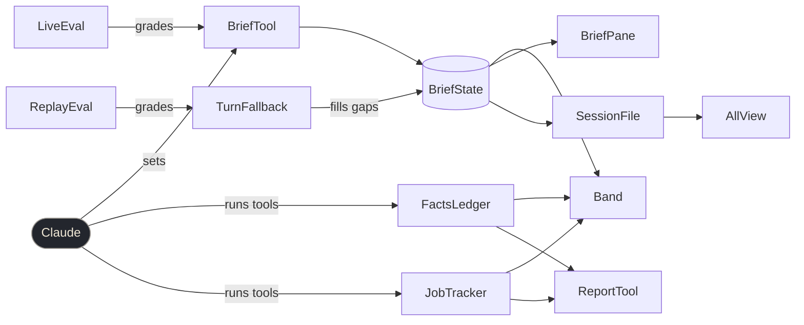

# brief: one glance at a session

1. **Intent** — Know what Claude needs, at a glance

2. **Decisions**
- **One mod, two layers over one model-written blob** — facts (actions, jobs, context) stay deterministic so the narrative can be checked against them, not trusted.
- **Model writes the brief via a tool over a turn-end fork** — `$.model.fork` re-reads the whole transcript on the main model, every turn [^E2]; a tool call is near free and updates mid-run. Needs a system-prompt sentence or it goes unused [^E1].
- **Full-list replacement over add/resolve ops** — each call carries every open ask, so a stale ask cannot outlive the next update (assumption).
- **Haiku over the final answer as fallback, not fork** — when a turn ends without a brief call, summarize `turn.complete`'s `answer` [^E5]; costs ~$0.0001 [^E7].
- **Replay on private transcripts + live `plugin eval` without Bash** — 410 real transcripts carry a "Blocked on me" answer key [^E3] but the repo is public [^E6]; Bash-granting cases refuse to run here [^E4].

3. **Components**
- **FactsLedger** — records outward actions, edited files, context use
- **JobTracker** — follows background shells, agents, watched logs
- **BriefTool** — lets the model set status and open asks
- **TurnFallback** — writes the brief when a turn skipped BriefTool
- **BriefState** — holds status, asks, source, timestamps
- **Band** — two-line glance above the prompt
- **BriefPane** — `/brief` detail: asks, jobs, ledger, context
- **SessionFile** — mirrors BriefState for other sessions to read
- **AllView** — `/brief all`: open asks across live sessions
- **ReportTool** — hands facts and asks to the end-of-run report
- **ReplayEval** — scores TurnFallback against real transcripts, offline
- **LiveEval** — checks the model calls BriefTool, accurately

4. **Data flow**
1. Claude runs tools; FactsLedger and JobTracker record what happened (ported unchanged).
2. Claude calls BriefTool on a phase change and before ending a turn; BriefTool replaces BriefState.
3. A main-loop turn ends without a BriefTool call; TurnFallback asks haiku to update BriefState from the answer.
4. Band reads BriefState, FactsLedger and JobTracker and draws status, then asks (yellow until the person replies).
5. BriefState changes; SessionFile writes it to `~/.claude/mods-data/brief/<session>.json`; AllView reads every file.
6. Claude ends a run; ReportTool returns facts + asks; Claude writes Changed / Blocked on me / Found from it [^E1].
7. ReplayEval feeds TurnFallback real turn ends and a judge grades it against the person's next message [^E3].
8. LiveEval runs scripted cases with and without the mod and grades BriefTool calls and asks [^E4].

5. **Data model**

| thing | why |
|---|---|
| `brief.state = {status ≤80ch, asks: {text, kind, since}[], source: tool\|fallback, at, turnId}` | what the Band shows; `since` kept when an ask's text is unchanged |
| `brief.repliedAt` | asks updated before the person's last prompt draw dim, not yellow |
| `run-ledger.*`, `jobs.*` state → `brief.*` | same shapes, renamed keys; nothing new stored |
| `~/.claude/mods-data/brief/<session>.json` | AllView's input; outside the public repo |
| replay results in `~/.claude/mods-data/brief/eval/` | transcript text never enters the repo; only aggregates go in the findings doc |

6. **Interfaces**
- `mcp__brief__brief({status, asks[]})` → `"ok"`. Errors: status >80ch or >5 asks → tool error naming the limit (model retries). Empty `asks` = nothing needed, not a failure.
- `mcp__brief__report()` → markdown facts + open asks. Never errors; empty ledger reads "nothing recorded".
- `/brief` (pane), `/brief all`, `/brief reset`; `/ledger` and `/jobs` stay as aliases.
- TurnFallback: haiku reply not JSON / API error → BriefState unchanged, debug log line; never blocks the turn.
- `evals/replay/replay.mjs --n 40` → `results.json` + score table. A sampled transcript with no next human message is skipped, not scored 0.

7. **Plan**
1. FactsLedger, JobTracker `[KEEP]` — move `ledger.ts`, `progress.ts` and their 18 tests into `brief/`; green before anything else.
2. BriefState, BriefTool, ReportTool `[NEW]` — tool + prompt.compose rule (replaces both mods' rules).
3. Band, BriefPane `[CHANGE]` — one renderer from the two mods' bands and the jobs pane.
4. TurnFallback `[NEW]` — pure `summarize.ts` prompt + parser, shared with ReplayEval.
5. SessionFile, AllView `[NEW]`.
6. ReplayEval `[NEW]` — tune TurnFallback's prompt; LiveEval `[NEW]` — tune BriefTool's rule.
7. `run-ledger`, `jobs` `[DROP]` — out of `CLAUDE_CODE_PLUGIN_DIRS` only after both evals pass.

8. **Done**
- Mod is sound · proof: `claude plugin validate brief && claude plugin test brief && tsc -p brief` → 0 errors, all tests pass (≥18 ported + new) · invariant: no test deleted from the port.
- Replay meets bar · proof: `node evals/replay/replay.mjs --n 40` → asks recall ≥0.8, false asks ≤10%, actionable ≥0.9, status supported ≥0.9 · invariant: same sample seed across runs.
- Live eval meets bar · proof: `claude plugin eval brief --runs 3 --no-publish` → BriefTool chosen in ≥90% of with-arm runs; asks graders ≥0.8 · invariant: no Bash in any case.
- Swapped · proof: `grep PLUGIN_DIRS .chezmoitemplates/claude-settings.json` → names `brief`, not `run-ledger` or `jobs`.

---

## Evidence

[^E1]: A model-facing mod tool needs a prompt sentence · `~/.claude/dev-mods/456467fb-d29c-4da9-a7a4-d9b56bb96fa2/EVAL-LEARNINGS.md` · run-ledger tool chosen 0/5 with description only, 3/3 with one `prompt.compose` sentence.
[^E2]: Fork cost · `grep -n "fork: (request" <plugin-authoring>/types/claude-code.d.ts` (2.1.296) · "the main thread's last request again (its model, system prompt, tools, messages)"; `ModelForkRequest` has only `prompt`, so no model or token cap.
[^E3]: Answer key exists · `grep -rl "Blocked on me" ~/.claude/projects --include='*.jsonl' | wc -l` · 410 (2026-10-12).
[^E4]: Bash cases refuse to run on this Mac · `ls ~/.docker/cli-plugins` → Docker Desktop symlinks; EVAL-LEARNINGS.md: "Any case that grants Bash is refused".
[^E5]: Turn-end text is available · `TurnCompleteFields.answer` in `claude-code.d.ts`: "The assistant's final visible text this turn".
[^E6]: Dotfiles repo is public · auto-memory `claude-skills-not-in-chezmoi.md`.
[^E7]: Haiku via a lean `claude -p` (`--setting-sources "" --strict-mcp-config --tools ""`, `CLAUDE_CODE_PLUGIN_DIRS=`) · one call cost $0.00001 for a 9-token reply (2026-10-12); a 2k-token answer is ~$0.0001–0.002 (assumption on scaling).
